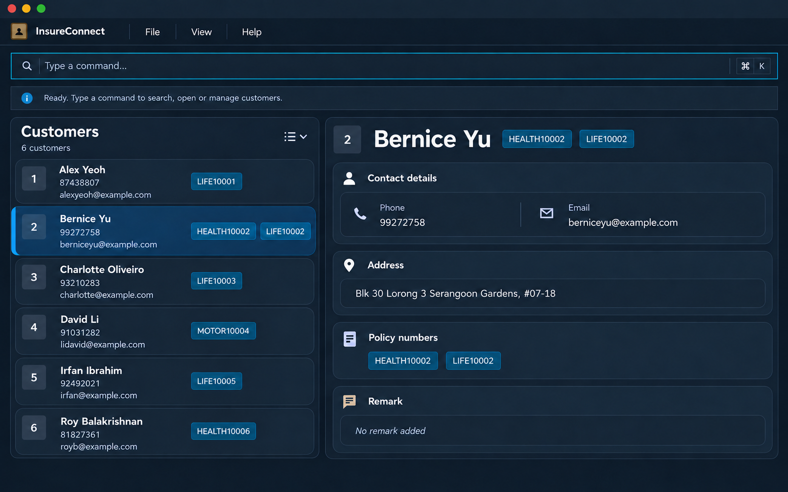

InsureConnect is a **desktop application for managing contacts, optimized for use through a Command Line Interface (CLI)** while retaining the benefits of a Graphical User Interface (GUI). If you type quickly, InsureConnect can help you manage contacts faster than traditional GUI applications.

* Table of Contents
{:toc}

--------------------------------------------------------------------------------------------------------------------

## Quick start

1. Ensure that Java `25` or later is installed on your computer. 
   **Mac users:** Ensure you have the precise JDK version prescribed [here](https://se-education.org/guides/tutorials/javaInstallationMac.html).

2. Download the latest `.jar` file from [here](https://github.com/AY2627S1-CS2103T-W09-4/tp/releases).

3. Copy the file to the folder you want to use as InsureConnect's _working directory_. InsureConnect stores its data and preferences relative to this folder.

4. Open a terminal, `cd` to that folder, and run `java -jar insureconnect.jar`. 
   Launch InsureConnect from this same directory each time to keep using the same records and preferences.
   A GUI similar to the one below should appear in a few seconds.  
   

5. Type a command in the command box and press Enter to execute it. For example, type **`help`** and press Enter to open the help window. 
   Some example commands you can try:

   * `list` : Lists all contacts.

   * `add n/John Doe p/98765432 e/johnd@example.com a/John street, block 123, #01-01, t/life123` : Adds a contact named `John Doe` to InsureConnect with policy number life123.

   * `delete 3` : Deletes the 3rd contact shown in the current list.

   * `clear` : Deletes all contacts.

   * `exit` : Exits the app.

6. Refer to the [Features](#features) section below for details of each command.

--------------------------------------------------------------------------------------------------------------------

## Keyboard navigation

Press **F6** to move focus between the **command box → output box → contacts list → command box**.
Press **Shift+F6** to move in the reverse direction. A thin outline marks the focused area.
These shortcuts work while typing commands or selecting output text, and preserve the command you are editing.
If focus is outside these areas, F6 enters the command box and Shift+F6 enters the contacts list.

Press **F1** to open the Help window. While the Help window is focused, press **F1** again or **Esc** to close it.

In the contacts list, use **Up/Down** to move between contacts and **Page Up/Page Down** to browse longer lists.
In the output box, use the arrow keys to move through feedback, **Shift+arrow keys** to select text,
and your system's copy shortcut (**Ctrl+C** on Windows/Linux, **Command+C** on macOS) to copy it.
The output is read-only. Press F6 twice from the output box to return to command entry.
On keyboards that reserve function keys for hardware controls, hold **Fn** as needed to send F1 or F6.

### Command history

In the command box, press **Up** to recall older commands and **Down** to move toward newer commands.
After the newest command, Down restores your unfinished draft, including its caret and selection.
Recalled commands are editable; press Enter to run them. Navigating again discards edits to a recalled command.
History includes successful and failed submissions, skips blank commands and consecutive identical submissions,
and lasts until you close the application. Navigation stops at the oldest command without wrapping.
Modified arrow shortcuts and arrow keys in other areas retain their usual behavior.

### Command suggestions

As you type the start of a command word, the rest of the word appears as faded text after the caret.
For example, typing `ed` shows `edit`. Press **Right** to fill in the suggested word, then continue typing as usual.
Pressing Right only fills in the word; press Enter to run the command.
When several commands match, the first in alphabetical order is suggested, so `c` suggests `clear`. Type more letters to narrow it down, such as `co` for `confirm`.
Suggestions appear only for command words, only while the caret is at the end of the text, and match lowercase input exactly.

## Changing the colour scheme

Choose **View → Colour scheme → Light** or **Dark** from the menu bar. The
selected option is marked in the menu and takes effect immediately in the main
window and Help window. Command errors remain highlighted in both schemes.

Dark is the default. Your choice is saved with your preferences when you exit
normally, and restored the next time you launch InsureConnect. Switching schemes
preserves your command text, output, and selected contact.

## Features

**:information_source: Notes about the command format:** 

* Words in `UPPER_CASE` are the parameters to be supplied by the user. 
  For example, in `add n/NAME`, replace `NAME` with a value such as `John Doe`.

* Items in square brackets are optional. 
  For example, `edit INDEX [n/NAME]` can be used as `edit 1 n/John Doe` or as `edit 1 p/98765432`.

* Items followed by `…`​ can appear zero or more times. 
  For example, `[t/POLICY_NUMBER]…​` in `edit` may be omitted, or written as `t/LIFE20481` or `t/LIFE20481 t/HEALTH20482`.

* Parameters can be in any order. 
  For example, if the command specifies `n/NAME p/PHONE_NUMBER`, `p/PHONE_NUMBER n/NAME` is also acceptable.

* **Name constraints**: `NAME` must start with an alphanumeric character and can only contain alphanumeric characters, spaces, and the characters: `-`, `'`, `.`, `/`, and `!`. Names cannot consist solely of punctuation (e.g. `---`, `...`, `///` are invalid).

* **Policy number constraints**: Each `t/POLICY_NUMBER` contains 1 to 30 letters or digits. Every customer needs at least one policy number, and a policy number can belong to only one customer. Policy numbers are case-insensitive and are displayed in updates. For example, life20481 and LIFE20481 refer to the same policy number.

* **Escape character (`!`) for name and remark prefix collisions**:
  Command prefixes are identified by a space followed by a letter and a slash (e.g. ` a/` for address, ` t/` for policy number). Names or remarks that contain these patterns can conflict with command prefixes if typed directly. 
  To avoid prefix collisions, prefix the collision point with an exclamation mark `!` within the name or remark field:
  * `n/Mohd !a/l Kassim` or `n/Mohd a!/l Kassim` will be saved as `Mohd a/l Kassim`.
  * Indian patronymics such as `s/o` or `d/o` (e.g. `n/Ravi s/o Muthu`) do not conflict with existing prefixes and do not require escaping (though `!s/o` is also supported).
  * In a remark, `r/dietary restrictions: !n/a` will be saved as `dietary restrictions: n/a`.
  * If you need a literal exclamation mark in a name or remark, type `!!` (for example, `r/Follow up!!` is saved as `Follow up!`).
  * **Warning:** A single `!` before any character is treated as an escape marker and removed. For example, `r/Great! Thanks` is saved as `Great Thanks`.
  * **Note:** `!` is treated as an escape character only in the name (`n/`) and remark (`r/`) fields. Other fields (such as `e/` email or `a/` address) do not use `!` as an escape character. Their own validation rules still apply; for example, email addresses containing `!` are not accepted.

* Extraneous parameters for commands that take no parameters, such as `help`, `exit`, and `clear`, are ignored. 
  For example, `help 123` is interpreted as `help`.

* If you are using a PDF version of this document, be careful when copying and pasting commands that span multiple lines as space characters surrounding line-breaks may be omitted when copied over to the application.

### Viewing help: `help`

Opens the Help window. It lists the formats for `add`, `edit`, `delete`, `find`, `list`, `clear`, `help`, and `exit`.
The window also shows a link to this User Guide; click **Copy URL** to copy the link to your clipboard.

You can open the same window from the **Help** menu or by pressing **F1**.
Press **F1** again or **Esc** to close the Help window while the Help window is focused.

Format: `help`

### Adding a person: `add`

Adds a person to InsureConnect.

A person is a duplicate only when both their name and phone number match an existing person.
Name matching ignores case, leading or trailing spaces, and repeated spaces between words.
Phone number matching ignores a leading `+`. For Singapore numbers, an 8-digit local
number is also treated as equivalent to the same number prefixed with the country code `65`.
For example, `+1800988989898989` matches `1800988989898989`, while `+6591110101`,
`6591110101`, and `91110101` are treated as the same phone number.
Customers with the same name but different phone numbers, or different names with the same
phone number, are allowed.

Format: `add n/NAME p/PHONE_NUMBER e/EMAIL a/ADDRESS t/POLICY_NUMBER [t/POLICY_NUMBER]…​ [r/REMARK]`

* Phone numbers must contain at least 3 digits. They may begin with a single `+` for an international country code.
  Spaces, letters, hyphens, parentheses, other punctuation, and a `+` anywhere else are not allowed.

:bulb: **Tip:**
A customer must have at least one policy number. An existing customer's policy number cannot be reused.

* `r/REMARK` is optional. If omitted, the customer's remark is empty. Remarks can be at most 500 characters after leading and trailing whitespace is removed and repeated whitespace is collapsed.
* Addresses can be at most 300 characters after leading and trailing whitespace is removed.

Examples:
* `add n/John Doe p/+6598765432 e/johnd@example.com a/John street, block 123, #01-01 t/LIFE20481`
* `add n/Betsy Crowe t/LIFE20482 e/betsycrowe@example.com a/Newgate Prison p/1234567 t/HEALTH20483`
* `add n/Ravi s/o Muthu p/91234567 e/ravi@example.com a/Blk 123 Jurong West t/LIFE20484`
* `add n/Mohd !a/l Kassim p/81234567 e/mohd@example.com a/Blk 456 Clementi Ave 3 t/LIFE20485`

### Listing all persons: `list`

Shows a list of all persons in InsureConnect. `list` uses the stored order, `list n/` sorts by name from A to Z (case-insensitive), and `list c/` sorts by creation time from oldest to newest. Sorting changes the displayed order only; the stored order is unchanged. The chosen sort stays in effect when you add a customer, so the new customer appears in its sorted position. A search replaces the sort.

Format: `list [n/|c/]`

Use either `n/` or `c/`, without a value. Other arguments are invalid.

### Editing a customer: `edit`

Edits an existing customer in InsureConnect.

Format: `edit INDEX [n/NAME] [p/PHONE] [e/EMAIL] [a/ADDRESS] [r/REMARK] [t/POLICY_NUMBER]…​`

* Edits the customer at the specified `INDEX`. The index refers to the index number shown in the displayed person list. The index **must be a positive integer** 1, 2, 3, …​
* After a successful edit, the active search filter is cleared and the full customer list is shown. This also happens if the edit changes a field used by the search, which ensures that the customer being edited is always visible in the customer list even after edits.
* At least one of the optional fields must be provided.
* Existing values will be updated to the input values.
* Fields that are omitted keep their existing values. To replace a remark, use `r/REMARK`; to clear it, use `r/` by itself. An empty `r/` counts as a field to edit.
* Addresses can be at most 300 characters after leading and trailing whitespace is removed.
* Remarks can be at most 500 characters after leading and trailing whitespace is removed and repeated whitespace is collapsed.
* An edit is rejected if the resulting name and phone number match another person, using the same duplicate rule as `add`.
* When editing policy numbers, all of the customer's existing policy numbers are replaced by those supplied; the change is not cumulative.
* At least one policy number must remain. `t/` without a value is rejected.

Examples:
*  `edit 1 p/91234567 e/johndoe@example.com` Edits the phone number and email address of the 1st person to be `91234567` and `johndoe@example.com` respectively.
*  `edit 2 n/Betsy Crower t/LIFE20486` Edits the name and replaces the policy numbers of the 2nd person.
*  `edit 1 n/Mohd !a/l Kassim` Edits the name of the 1st person to be `Mohd a/l Kassim`.
*  `edit 1 r/Prefers WhatsApp after 6pm` Replaces the 1st person's remark.
*  `edit 1 r/` Clears the 1st person's remark.

### Locating customers by name, phone or policy number: `find`

Finds customers by name keywords, phone prefix or exact policy number, optionally combined.

Format: `find KEYWORD [MORE_KEYWORDS]` or `find [n/KEYWORDS] [p/PHONE_PREFIX] [t/POLICY_NUMBER]`

* Name search is case-insensitive; for example, `hans` matches `Hans`.
* Keyword order does not matter; for example, `Hans Bo` matches `Bo Hans`.
* Unprefixed keywords search names only, including when a keyword contains digits.
* Keywords match the start of any name word; for example, `Han` matches `Hans` and `Bo Hans`.
* Customers with an exact name-word match appear before prefix-only matches. For example, `find John` shows
  `John Tan` before `Johnny Lim`. Matching is case-insensitive and considers any name word or keyword.
* Customers tied in match quality retain their stored order. Searching only changes the displayed order;
  `list` restores the full list in stored order, while `list n/` and `list c/` apply their respective sorts.
* Full words also match, but middle-of-word and suffix matches do not; for example, `ans` does not match `Hans`.
* Customers matching at least one keyword are returned (an `OR` search); for example, `Hans Bo` returns `Hans Gruber` and `Bo Yang`.

Examples:
* `find John` returns `john` and `John Doe`
* `find jo` returns `John Doe` and `Mary Jones`
* `find alex david` returns `Alex Yeoh`, `David Li` 
  

To search by phone number, use `find p/PHONE_PREFIX`, for example `find p/9876` or `find p/+65`.

* Phone searches match the beginning of the phone number, including the complete number.
  For example, `find p/9876` matches `98765432`, while `find p/+65` matches `+6591234567`.
* Supply an optional leading `+` followed by one or more digits (`0-9`). A single digit is allowed, and leading zeros
  are preserved. Spaces around the prefix are allowed; spaces within it, letters, hyphens, parentheses, other
  punctuation, and a `+` anywhere except the beginning are rejected.
* To combine phone and name criteria, use an explicit `n/` field as described below.
  Supplying multiple phone prefixes is not supported and produces an error.
* All customers with matching phone numbers are shown in stored order, including customers sharing a number.
  A phone-only search replaces the previous search and display sort. Use the displayed indexes for `edit` and `delete`.

#### Combining search criteria

Use `n/` for name keywords, `p/` for a phone prefix, and `t/` for an exact policy number.
Supply at least one field, once each, in any order. A customer must match **every supplied field (AND)**;
within `n/`, matching **any keyword (OR)** is sufficient. Policy searches match any policy belonging to the customer.

* `find n/Alice Bob p/912` finds customers matching Alice or Bob whose phone numbers start with 912.
* `find n/Alice p/912 t/LIFE20001` also requires the policy number LIFE20001, ignoring case.
* `find t/LIFE20001` searches by policy number alone.

Name matching remains case-insensitive and ranks exact name words before prefix-only matches.
Phone prefixes contain digits only with an optional leading `+`. Policy numbers match exactly, ignoring case, and contain 1–30 letters or digits.
Phone and policy searches without a name criterion retain stored order.
Each new search replaces the previous filter; it does not narrow the previous results.

Empty values and repeated fields are rejected. Use `find n/Alice p/912`, not `find Alice p/912`.
Only `n/`, `p/`, and `t/` are supported in prefixed searches; `e/`, `a/`, and `r/` are rejected.
As in `add`, escape those prefixes with `!` when they are part of a name, for example `find n/Mohd !a/l`.
Other slashes need no escaping, for example `find n/Ravi s/o p/912`.
Existing unprefixed name searches and `find p/DIGITS` remain available.

To search by policy number, use `find t/POLICY_NUMBER`, for example `find t/LIFE20001`.

* Policy-number searches use an exact match and are case-insensitive. For example,
  `find t/life20001` finds a customer with policy number `LIFE20001`.
* Supply exactly one policy number containing 1 to 30 letters or digits. Spaces, punctuation,
  and multiple policy numbers are rejected.
* Combine `t/` with explicit `n/` and `p/` fields as described above.
* A policy-number search replaces the previous search and display sort. Use the displayed
  indexes for `edit` and `delete`.

### Deleting a person: `delete`

Requests deletion of the specified person from InsureConnect. The person is deleted only after confirmation.

Format: `delete INDEX`

Confirmation format: `confirm`

* `delete INDEX` shows the person at the specified `INDEX` and requests confirmation.
* Enter `confirm` immediately after a delete request to permanently delete that person.
* Any other command cancels the pending deletion.
* The index refers to the index number shown in the displayed person list.
* The index **must be a positive integer** 1, 2, 3, …​

Examples:
* `list` followed by `delete 2`, then `confirm`, deletes the 2nd person in InsureConnect.
* `find Betsy` followed by `delete 1`, then `confirm`, deletes the 1st person in the results of the `find` command.

### Clearing all entries: `clear`

Clears all entries from InsureConnect after confirmation.
If there are no customers to clear, InsureConnect displays a message and does not request confirmation.
When prompted, enter `y` to clear the records. The response is case-insensitive (i.e. `y` and `Y` are equivalent). 
Enter `n`, press Enter without a response, or enter anything else to cancel. The default response is `n`.

Format: `clear`

### Exiting the program: `exit`

Exits the program.

Format: `exit`

### Saving the data

InsureConnect automatically saves data after every command. You do not need to save manually.

### Editing the data file

InsureConnect saves its files relative to the working directory (the directory from which you launch it): customer records are saved to `data/addressbook.json`, and preferences are saved to `preferences.json`. For example, if you run the JAR by its full path while your terminal is in `/home`, the files are `/home/data/addressbook.json` and `/home/preferences.json`, regardless of where the JAR is stored. Launching InsureConnect from different directories uses different records and preferences files. Launch it from the same directory each time to keep using the same records and preferences. The legacy data filename is retained so existing installations continue to load their records. Advanced users are welcome to update data directly by editing `data/addressbook.json`.

Addresses already saved with more than 300 characters are loaded and preserved as-is. The 300-character limit applies to addresses entered with the `add` and `edit` commands.

:exclamation: **Caution:**
If your changes make the data file invalid, InsureConnect starts with an empty contact list at the next run. The invalid file remains on disk until you run a command (InsureConnect saves after every command). Still, we recommend backing up the file before editing it. 
Furthermore, certain edits can cause InsureConnect to behave in unexpected ways (e.g., if a value entered is outside of the acceptable range). Therefore, edit the data file only if you are confident that you can update it correctly.

--------------------------------------------------------------------------------------------------------------------

### Loading contact files from older versions

Contact files without `createdAt` timestamps load automatically. Their existing
contact details are preserved, and unknown creation dates use
`1970-01-01T00:00:00Z` as a stable fallback for creation-date sorting. This is a
migration value, not the actual creation date. The timestamp is written on the
next successful save; loading alone does not rewrite the file. Existing valid
timestamps are retained. Malformed timestamps and other invalid contact data
still produce a loading warning. Old labels are not converted into policy
numbers: policy numbers must still be valid and unique across contacts.

## FAQ

**Q**: How do I transfer my data to another computer? 
**A**: Install the app on the other computer and overwrite the data file it creates with the `data/addressbook.json` file from your previous InsureConnect working directory.

--------------------------------------------------------------------------------------------------------------------

## Known issues

1. **When using multiple screens**, if you move the application to a secondary screen, and later switch to using only the primary screen, the GUI will open off-screen. The remedy is to delete the `preferences.json` file created by the application before running the application again.
2. **If you minimize the Help Window** and then run the `help` command (or use the `Help` menu, or the keyboard shortcut `F1`) again, the original Help Window will remain minimized, and no new Help Window will appear. The remedy is to manually restore the minimized Help Window.

--------------------------------------------------------------------------------------------------------------------

## Command summary

Action | Format, Examples
--------|------------------
**Add** | `add n/NAME p/PHONE_NUMBER e/EMAIL a/ADDRESS t/POLICY_NUMBER [t/POLICY_NUMBER]…​ [r/REMARK]`   e.g., `add n/James Ho p/22224444 e/jamesho@example.com a/123, Clementi Rd, 1234665 t/LIFE20481 t/HEALTH20482`   e.g. escaping `a/`: `add n/Mohd !a/l Kassim p/81234567 e/mohd@example.com a/Blk 456 Clementi Ave 3 t/LIFE20483`
**Clear** | `clear`
**Delete** | `delete INDEX`  e.g., `delete 3`
**Edit** | `edit INDEX [n/NAME] [p/PHONE_NUMBER] [e/EMAIL] [a/ADDRESS] [r/REMARK] [t/POLICY_NUMBER]…​`  e.g., `edit 2 n/James Lee e/jameslee@example.com`  e.g., `edit 1 r/Follow up next week`  e.g. escaping `a/`: `edit 1 n/Mohd !a/l Kassim`
**Find** | `find KEYWORD [MORE_KEYWORDS]` or `find [n/KEYWORDS] [p/PHONE_PREFIX] [t/POLICY_NUMBER]`  e.g., `find James Jake`, `find n/Alice p/912 t/LIFE20001`
**List** | `list [n/|c/]`  e.g., `list n/`, `list c/`
**Help** | `help`
